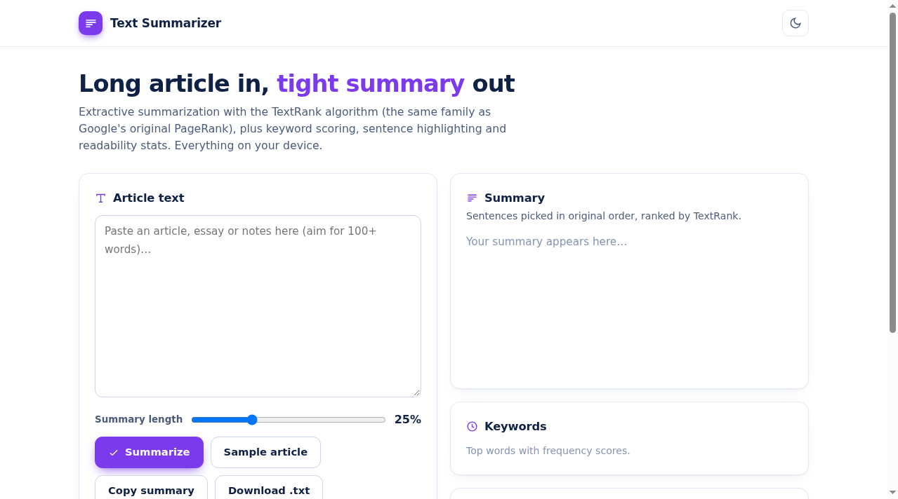
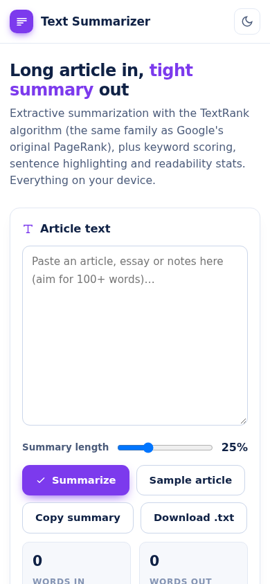

# Text Summarizer

Paste an article and get a tight extractive summary, powered by TextRank - the graph algorithm from the same family as Google's original PageRank - running entirely in your browser.

**Live demo: https://akash991833.github.io/text-summarizer/**



## Features

- **True TextRank** - sentences become nodes, cosine-overlap becomes weighted edges, and 40 rounds of PageRank-style iteration rank every sentence. Picks are shown in original order.
- **Adjustable length** from 10% to 60% of the source.
- **Keyword extraction** with frequency bars.
- **"Why these sentences" view** - the original article with chosen sentences highlighted, each tagged with its TextRank score.
- **Stats**: words in/out, compression ratio, and a Flesch readability score for the source.
- **Sample article, one-click copy, .txt download.**
- **Dark and light mode**, mobile friendly, installable PWA, fully offline.



## Honest limits

Extractive summaries pick the most central existing sentences; they do not rewrite or paraphrase like a large language model, so flow can feel choppy on some texts.

## Tech

Vanilla HTML/CSS/JS, hand-rolled sentence tokenizer, graph ranking and readability scoring. No libraries, no network calls.

## Run locally

```bash
python3 -m http.server 8000
```

---

## 🐍 Python version (real ML backend) - `python-app/`

The browser demo above is fully client-side. This folder is the **pro-grade version** with a real training pipeline on real data:

Abstractive summarization with a fine-tuned T5: paste long articles, get a compressed gist with length and style controls. Stack: Python, Gradio, Transformers (CPU).

```bash
cd python-app
pip install -r requirements.txt
python app.py
```

Deploy free on **Hugging Face Spaces** (no card): create a Space, upload the `python-app/` folder - it ships Space-ready (`sdk` + `app_file` already set in its README).
